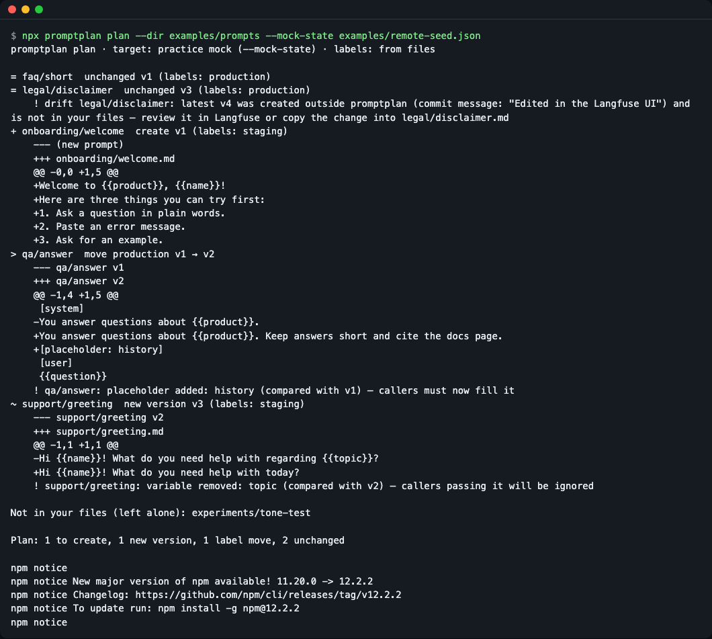
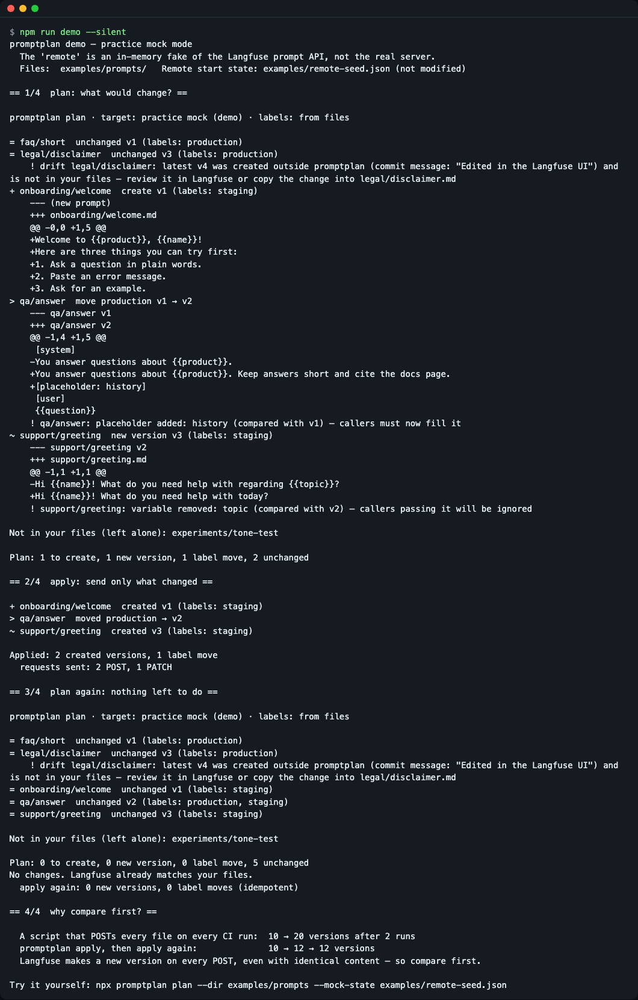
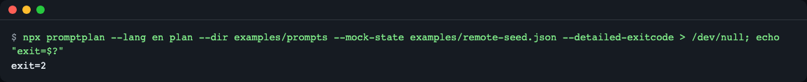
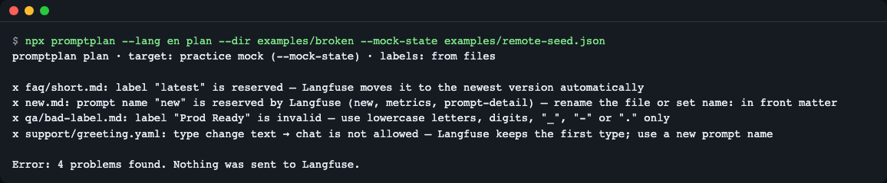
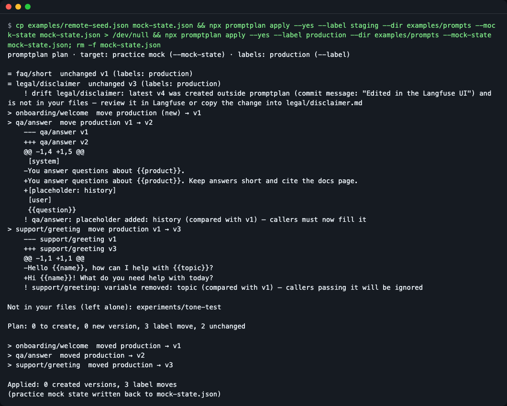
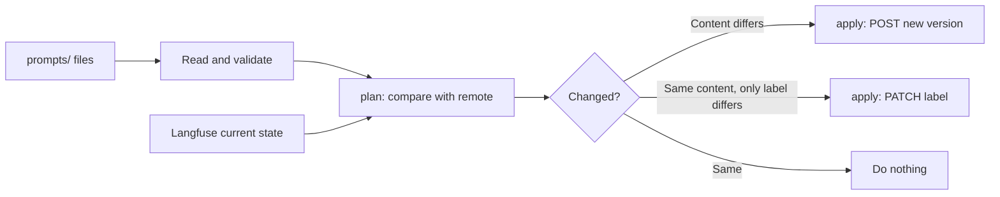

# promptplan

[한국어](README.md) | **English**

Git-first prompt deployment for Langfuse: `plan` shows what would change, `apply` creates a new version only when the content changed and moves labels otherwise. For teams that keep prompts in Git, review them in pull requests and deploy from CI. Try it without an account: `git clone https://github.com/LeeGyeongPil/promptplan && cd promptplan && npm install && npm run demo` (practice mock mode).

A CLI that compares a folder of prompt files with Langfuse, shows you "what will change" in advance (`plan`), and then uploads only what changed as a new version or only moves labels (`apply`). It removes the problem of a hand-written deploy script piling up versions with identical content.


*`promptplan plan` showing the differences between the folder and the (practice mock) server with the symbols `+ ~ > =` and warnings*

## Who it's for
- When you run prompt versions and labels in Langfuse, keep the originals in Git, and want to deploy only what passed PR review
- When you don't want a new version with identical content piling up every time CI runs
- When you want to avoid overwriting, without knowing it, a version someone edited directly in the Langfuse UI (drift)
- When you want to catch, at review time, a change that deletes a `{{variable}}` from a prompt and breaks app code

By analogy, it's "terraform for prompts." The folder = the desired state, Langfuse = the current state, `plan` = the difference, `apply` = making them match.

## Install
Prerequisite: Node.js 22 or later (check with `node --version`). For installation help, see https://nodejs.org. A minimal Linux environment needs `git` plus Node.js and npm.

It is not published to the npm registry yet. For now, get the repository and build it locally.

```bash
git clone https://github.com/LeeGyeongPil/promptplan
cd promptplan
npm install        # The prepare step builds TypeScript into dist/
npm run demo       # Practice mock mode — no account or key needed
```

To use it in your own project's CI, you can also fetch it straight from GitHub (once the repository is public).
```bash
npx --yes github:LeeGyeongPil/promptplan plan --dir prompts
```

## Quick start
Inside the repository, compare the example folder with a practice server state.

```bash
npx promptplan plan --dir examples/prompts --mock-state examples/remote-seed.json
```

```
promptplan plan · target: practice mock (--mock-state) · labels: from files

= faq/short  unchanged v1 (labels: production)
= legal/disclaimer  unchanged v3 (labels: production)
    ! drift legal/disclaimer: latest v4 was created outside promptplan (commit message: "Edited in the Langfuse UI") and is not in your files — review it in Langfuse or copy the change into legal/disclaimer.md
+ onboarding/welcome  create v1 (labels: staging)
    ...
> qa/answer  move production v1 → v2
    ...
~ support/greeting  new version v3 (labels: staging)
    ...

Not in your files (left alone): experiments/tone-test

Plan: 1 to create, 1 new version, 1 label move, 2 unchanged
```
(The diff lines are shortened to `...`. You can see the full output in the screenshot above and in `npm run demo`.)

How to read it:

| Symbol | Meaning |
|---|---|
| `+` | Create a new prompt (create) |
| `~` | The content changed, so create a new version |
| `>` | Move only a label (for example, production) to a different version, with no new version |
| `=` | Already the same |
| `!` | Warning: drift, added or removed variables or placeholders, tags |
| `x` | Error: in this state, nothing is sent to Langfuse |

A "label" is a name tag attached to a version. The app reads the version carrying the `production` label, so promotion is not a new version but moving the tag (an arrow).

### The full flow in 30 seconds (`npm run demo`)
It shows plan → apply → plan in sequence against the practice mock.


*apply sends only the requests it needs (2 POST, 1 PATCH), and planning again shows no changes. The bottom compares version counts with a script that does no comparison*

**Practice mock mode**: The demo runs against an in-memory fake server that imitates the Langfuse prompt API. It does not guarantee responses identical to the real server (reproduced from reading the source, 2026-11-10). The real Langfuse is a shared resource and can be slow, so every request has a 120-second timeout.

## Usage

| Command / option | What it does | Example |
|---|---|---|
| `plan` | Only compares the folder with Langfuse (changes nothing) | `promptplan plan --dir prompts` |
| `plan --format markdown` | Output as a table for PR comments (`text`, `markdown`, `json`) | `promptplan plan --format markdown > plan.md` |
| `plan --detailed-exitcode` | Exit code 2 if there are changes, 0 if none (1 for errors) | `promptplan plan --detailed-exitcode` |
| `apply` | Uploads only what changed as a new version, and only moves labels if the content is the same | `promptplan apply --yes --dir prompts` |
| `--label <l>` (repeatable) | Applies this label to all prompts instead of the file's labels = promotion | `promptplan apply --yes --label production` |
| `--message`, `-m` | Commit message of the new version (stored as `[promptplan] <m>`) | `-m "fix tone"` |
| `--yes`, `-y` | Apply without confirmation. Required where there is no terminal (CI) | |
| `pull` | Saves prompts carrying a label (default `production`) to files. Overwrite with `--force` | `promptplan pull --dir prompts` |
| `mock` | Runs a practice mock server until Ctrl+C | `promptplan mock --port 3999 --seed examples/remote-seed.json` |
| `demo` | The plan → apply → plan demo | `promptplan demo` |
| `--mock-state <file>` | Use a practice mock that starts from this JSON instead of Langfuse (apply writes the result back to the file) | `--mock-state examples/remote-seed.json` |
| `--env-file <file>` | Read keys from a file | `--env-file .env` |
| `--no-color` | Turn off color (`NO_COLOR` is also recognized) | |

Exit codes: 0 normal · 2 changes exist (only with `plan --detailed-exitcode`) · 1 error. A folder with no prompt files at all (an empty folder, or a wrong `--dir`) is also an error (1).

### Prompt file format
- Text prompts are `.md`, chat prompts are `.yaml`/`.yml`. The name is the path relative to `--dir` without the extension (`support/greeting.md` → `support/greeting`), and you can override it with `name` in the front matter.
- Front matter keys: `name`, `type`, `labels`, `config`, `tags`, `commitMessage` (chat adds `messages`). An unknown key is an error.
- Chat messages are `{role, content}` or `{placeholder: <name>}`.

```markdown
---
labels: [staging]
config: { model: gpt-4o-mini, temperature: 0.2 }
tags: [support]
---
Hi {{name}}! What do you need help with today?
```

```yaml
labels: [production, staging]
messages:
  - role: system
    content: You answer questions about {{product}}.
  - placeholder: history
  - role: user
    content: "{{question}}"
```

### Scenario 1: Preview changes in a PR
```bash
npx promptplan plan --dir examples/prompts --mock-state examples/remote-seed.json --format markdown > plan.md
```
You get Markdown containing a table and collapsible diffs. The example workflow posts this as a PR comment.

To branch in a script on whether there are changes:

```bash
npx promptplan plan --dir examples/prompts --mock-state examples/remote-seed.json --detailed-exitcode > /dev/null; echo "exit=$?"
```
```
exit=2
```

*Exit code 2 because there are changes*

### Scenario 2: Block bad files before sending
```bash
npx promptplan plan --dir examples/broken --mock-state examples/remote-seed.json
```

*A reserved label `latest`, an invalid label, a reserved name, and a type change (text→chat) are blocked with 4 errors before sending. Exit code 1, and nothing goes to the server*

### Scenario 3: Upload to staging and promote to production
```bash
cp examples/remote-seed.json mock-state.json
npx promptplan apply --yes --label staging    --dir examples/prompts --mock-state mock-state.json
npx promptplan apply --yes --label production --dir examples/prompts --mock-state mock-state.json
rm mock-state.json
```
The first apply uploads only the changed content as new versions. The second (promotion) gives `Applied: 0 created versions, 3 label moves` — it moves only the production label, with no new versions.


*Result of the promotion step: 3 label moves, 0 new versions*

If you download the server's production prompts into files with `pull`, `plan` immediately says "No changes" (a round-trip check).

## Settings
To connect to a real Langfuse, copy `.env.example` to `.env` and fill it in (do not commit `.env`).

```bash
cp .env.example .env
npx promptplan plan --dir prompts --env-file .env
```

| Variable | Meaning |
|---|---|
| `LANGFUSE_PUBLIC_KEY` | The (public) API key from the Langfuse project settings |
| `LANGFUSE_SECRET_KEY` | The (secret) API key |
| `LANGFUSE_BASE_URL` | Default `https://cloud.langfuse.com` (EU). For US, `https://us.cloud.langfuse.com`; for self-hosting, your own address |

Environment variables that are already set take precedence over `--env-file` values. If there are neither keys nor `--mock-state`, it ends with exit code 1 and a message on what to do.

**Differences between mock mode and real mode**: The mock is a local server that imitates the same rules (a POST always creates a new version, `latest` moves automatically, a label sits on only one version), so it needs no key and is fast. To see differences from the real server, run `plan --env-file .env` in your own environment.

### Hooking it into CI
Copy `examples/github-actions/promptplan.yml` into your repository's `.github/workflows/`.

- PR: posts the result of `plan --label staging --format markdown` to a PR comment and the job summary
- Merge to main: `apply --yes --label staging` (only changed content becomes a new version)
- Manual run: `apply --yes --label production` (label moves only)

The secrets are `LANGFUSE_PUBLIC_KEY` and `LANGFUSE_SECRET_KEY` (plus `LANGFUSE_BASE_URL` for US or self-hosting). The new version's commit message records `[promptplan] apply <7-character commit>`.

## How it works



- It reads and validates the files. If there is a problem, it stops here and sends nothing to the server.
- For each prompt, it fetches the remote's latest version and the versions currently carrying that label, and compares the content.
- If a version with the same content already exists, it does not create a new version and only moves the label. Langfuse creates a new version on every POST even when the content is the same, so comparing first is the key.
- A label move is a PATCH, so it can only add labels and cannot remove them.
- If the latest version is not in your files and was created without the `[promptplan]` marker, it is only warned about as drift and not overwritten.
- Write requests are sent one at a time and stop at the first error. If you apply again, what finished shows as `=` (idempotent). A POST that creates a new version is not retried automatically even if the response fails (the server may already have created it, so the same version would be created again).

Reference: the official Langfuse docs https://langfuse.com/docs/prompt-management (checked 2026-11-10).

## When to use it
- Use it when: you keep prompt originals in Git, review them in PRs, reflect them in Langfuse via CI, and want a new version created only when the content changes.
- Scope: limited to file↔Langfuse synchronization of prompts. It does not cover evaluation or tracing.
- Use another tool when: you want a mirror going from Langfuse out to Git → Langfuse's official [GitHub integration](https://langfuse.com/docs/prompt-management/features/github-integration); a general-purpose 1:1 direct call of the API → the official [Langfuse CLI](https://langfuse.com/changelog/2026-02-17-langfuse-cli) (checked 2026-11-10; check the features against the official docs at the link).

## Troubleshooting
| Symptom | Cause | Fix |
|---|---|---|
| `No Langfuse keys found` | There are neither keys nor `--mock-state` | Give keys with `--env-file .env`, or practice with `--mock-state examples/remote-seed.json` |
| `apply needs --yes when not running in an interactive terminal` | A confirmation question cannot be asked where there is no terminal, such as CI | `apply --yes` |
| `label "latest" is reserved` | Langfuse attaches `latest` to the newest version automatically | Remove `latest` from the file's `labels` |
| `type change text → chat is not allowed` | Langfuse keeps the type chosen first | Use a new prompt name |
| `drift ...` warning | There is a latest version created outside promptplan, for example in the Langfuse UI | Check it in Langfuse or reflect the change in the file. It is not overwritten |
| You removed a label from the file but it remains on the server | A label PATCH only adds or moves and cannot remove | Remove it yourself in the Langfuse UI |
| `no prompt files (.md, .yaml, .yml) in ...` or `prompt folder not found` | The `--dir` folder is empty or the path is wrong (exit code 1) | Check the `--dir` path and put in `.md`, `.yaml`, `.yml` files |
| `mock-state.json` changed after `apply --mock-state` | Only `apply` writes the result back to that file (`plan` only reads) | Copy the seed and use the copy, then delete it when done |

## Development and contributing
```bash
npm test    # 31 tests after the build, no network
```
Please leave bugs and suggestions as issues. The change log is [CHANGELOG.md](CHANGELOG.md).

## License
MIT. The practice mock server uses no external model or data. The only runtime dependency is `yaml`.
