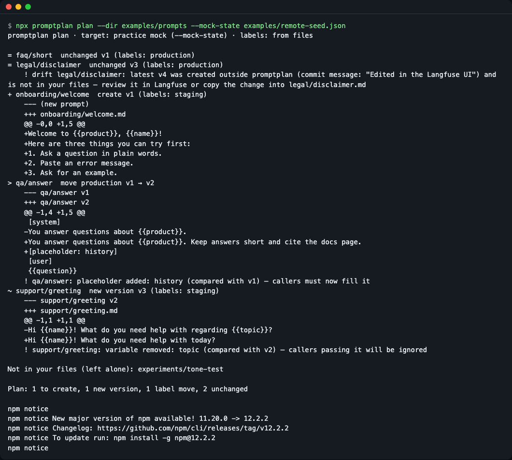
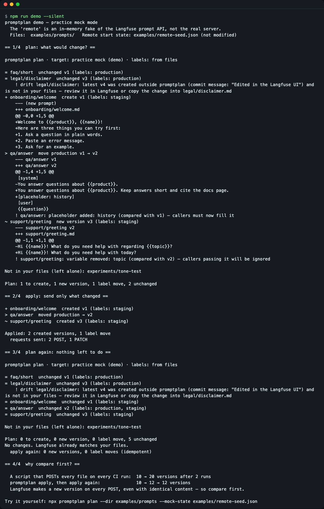
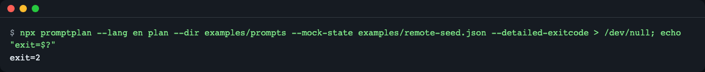
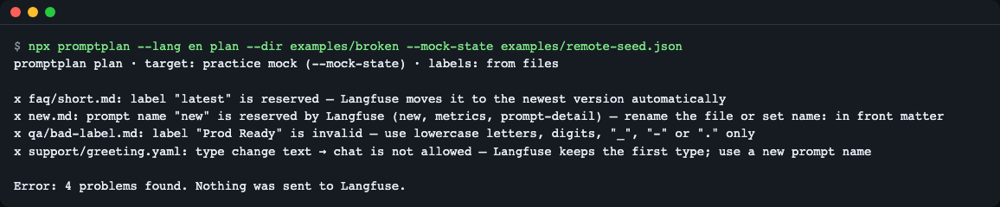
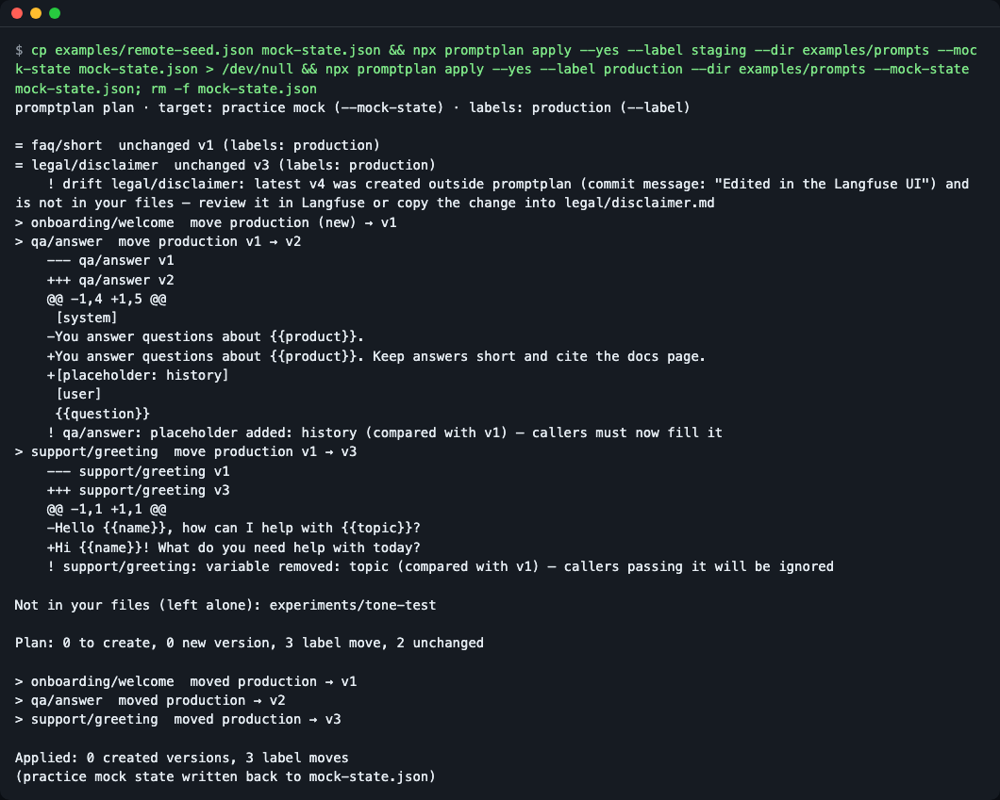
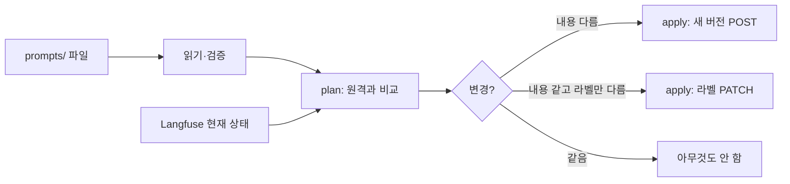

# promptplan

> **English summary** — Git-first prompt deployment for Langfuse: `plan` shows what would change, `apply` creates a new version only when the content changed and moves labels otherwise. For teams that keep prompts in Git, review them in pull requests and deploy from CI. Try it without an account: `git clone https://github.com/LeeGyeongPil/promptplan && cd promptplan && npm install && npm run demo` (practice mock mode).

프롬프트 파일 폴더와 Langfuse 를 비교해서 "무엇이 바뀌는지"를 미리 보여 주고(`plan`), 바뀐 것만 새 버전으로 올리거나 라벨만 옮기는(`apply`) CLI 입니다. 손으로 짠 deploy 스크립트가 같은 내용으로 버전을 계속 쌓는 문제를 없애 줍니다.


*`promptplan plan` 이 폴더와 (연습용 목) 서버의 차이를 `+ ~ > =` 기호와 경고로 보여 주는 화면*

## 이런 분께
- Langfuse 로 프롬프트 버전·라벨을 운영하면서, 원본은 Git 에 두고 PR 리뷰를 거친 것만 배포하고 싶을 때
- CI 가 돌 때마다 같은 내용의 새 버전이 쌓이는 것이 싫을 때
- 누가 Langfuse 화면에서 직접 고친 버전(드리프트)을 모르고 덮어쓰는 일을 피하고 싶을 때
- 프롬프트에서 `{{변수}}` 를 지워 앱 코드가 깨지는 변경을 리뷰 단계에서 보고 싶을 때

비유하면 "프롬프트용 terraform" 입니다. 폴더 = 원하는 모습, Langfuse = 지금 모습, `plan` = 차이, `apply` = 맞추기.

## 설치
전제: Node.js 22 이상(`node --version` 으로 확인). 설치 안내는 https://nodejs.org 를 참고하세요. 최소 리눅스 환경에는 `git` 과 Node.js·npm 이 필요합니다.

npm 레지스트리에는 아직 게시하지 않았습니다. 지금은 저장소를 받아 로컬에서 빌드합니다.

```bash
git clone https://github.com/LeeGyeongPil/promptplan
cd promptplan
npm install        # prepare 단계가 TypeScript 를 dist/ 로 빌드합니다
npm run demo       # 연습용 목 모드 — 계정·키 불필요
```

내 프로젝트의 CI 에서 쓸 때는 GitHub 에서 바로 받는 방법도 있습니다(저장소가 공개된 뒤).
```bash
npx --yes github:LeeGyeongPil/promptplan plan --dir prompts
```

## 빠르게 시작하기
저장소 안에서 예제 폴더와 연습용 서버 상태를 비교해 봅니다.

```bash
npx promptplan plan --dir examples/prompts --mock-state examples/remote-seed.json
```

```
promptplan plan · target: practice mock (--mock-state) · labels: from files

= faq/short  unchanged v1 (labels: production)
= legal/disclaimer  unchanged v3 (labels: production)
    ! drift legal/disclaimer: latest v4 was created outside promptplan (commit message: "Edited in the Langfuse UI") and is not in your files — review it in Langfuse or copy the change into legal/disclaimer.md
+ onboarding/welcome  create v1 (labels: staging)
    ...
> qa/answer  move production v1 → v2
    ...
~ support/greeting  new version v3 (labels: staging)
    ...

Not in your files (left alone): experiments/tone-test

Plan: 1 to create, 1 new version, 1 label move, 2 unchanged
```
(diff 줄은 `...` 로 줄였습니다. 전체 출력은 위 스크린샷과 `npm run demo` 에서 볼 수 있습니다.)

읽는 법:

| 기호 | 뜻 |
|---|---|
| `+` | 새 프롬프트 만들기(create) |
| `~` | 내용이 바뀌어 새 버전 만들기 |
| `>` | 새 버전 없이 라벨(예: production)만 다른 버전으로 옮기기 |
| `=` | 이미 같음 |
| `!` | 경고: 드리프트, 변수·플레이스홀더 추가·삭제, 태그 |
| `x` | 오류: 이 상태면 Langfuse 에 아무것도 보내지 않음 |

"라벨"은 버전에 붙이는 이름표입니다. 앱은 `production` 라벨이 붙은 버전을 읽으므로, 승격은 새 버전이 아니라 이름표(화살표) 이동입니다.

### 30초 전체 흐름 (`npm run demo`)
plan → apply → plan 을 연습용 목으로 차례로 보여 줍니다.


*apply 는 필요한 요청만(2 POST, 1 PATCH) 보내고, 다시 plan 하면 변경 없음. 맨 아래는 비교 없는 스크립트와의 버전 수 비교*

**연습용 목(mock) 모드**: 데모는 Langfuse 프롬프트 API 를 흉내 낸 메모리 속 가짜 서버로 동작합니다. 실제 서버와 응답이 완전히 같다고 보장하지 않습니다(소스 읽기 기반으로 재현, 2026-11-10). 실제 Langfuse 는 공유 자원이라 느릴 수 있어 요청마다 120초 타임아웃을 둡니다.

## 사용법

| 명령·옵션 | 하는 일 | 예 |
|---|---|---|
| `plan` | 폴더와 Langfuse 를 비교만 함(아무것도 바꾸지 않음) | `promptplan plan --dir prompts` |
| `plan --format markdown` | PR 코멘트용 표로 출력 (`text`·`markdown`·`json`) | `promptplan plan --format markdown > plan.md` |
| `plan --detailed-exitcode` | 변경이 있으면 종료 코드 2, 없으면 0 (오류는 1) | `promptplan plan --detailed-exitcode` |
| `apply` | 바뀐 것만 새 버전으로 올리고, 같은 내용이면 라벨만 옮김 | `promptplan apply --yes --dir prompts` |
| `--label <l>` (반복 가능) | 파일의 라벨 대신 이 라벨을 모든 프롬프트에 적용 = 승격 | `promptplan apply --yes --label production` |
| `--message`, `-m` | 새 버전의 커밋 메시지(`[promptplan] <m>` 로 저장) | `-m "fix tone"` |
| `--yes`, `-y` | 확인 없이 적용. 터미널이 아닌 곳(CI)에서는 필수 | |
| `pull` | 라벨(기본 `production`)이 붙은 프롬프트를 파일로 저장. `--force` 로 덮어쓰기 | `promptplan pull --dir prompts` |
| `mock` | 연습용 목 서버를 Ctrl+C 까지 띄움 | `promptplan mock --port 3999 --seed examples/remote-seed.json` |
| `demo` | plan → apply → plan 데모 | `promptplan demo` |
| `--mock-state <file>` | Langfuse 대신 이 JSON 으로 시작하는 연습용 목 사용(apply 는 결과를 파일에 다시 씀) | `--mock-state examples/remote-seed.json` |
| `--env-file <file>` | 키를 파일에서 읽기 | `--env-file .env` |
| `--no-color` | 색 끄기(`NO_COLOR` 도 인식) | |

종료 코드: 0 정상 · 2 변경 있음(`plan --detailed-exitcode` 일 때만) · 1 오류. 프롬프트 파일이 하나도 없는 폴더(빈 폴더·잘못된 `--dir`)도 오류(1)입니다.

### 프롬프트 파일 형식
- 텍스트 프롬프트는 `.md`, 채팅 프롬프트는 `.yaml`/`.yml`. 이름은 `--dir` 기준 경로에서 확장자를 뺀 것(`support/greeting.md` → `support/greeting`)이고, 프론트매터의 `name` 으로 바꿀 수 있습니다.
- 프론트매터 키: `name`, `type`, `labels`, `config`, `tags`, `commitMessage`(채팅은 `messages` 추가). 모르는 키는 오류입니다.
- 채팅 메시지는 `{role, content}` 또는 `{placeholder: <이름>}`.

```markdown
---
labels: [staging]
config: { model: gpt-4o-mini, temperature: 0.2 }
tags: [support]
---
Hi {{name}}! What do you need help with today?
```

```yaml
labels: [production, staging]
messages:
  - role: system
    content: You answer questions about {{product}}.
  - placeholder: history
  - role: user
    content: "{{question}}"
```

### 시나리오 1: PR 에서 변경 미리 보기
```bash
npx promptplan plan --dir examples/prompts --mock-state examples/remote-seed.json --format markdown > plan.md
```
표와 접이식 diff 가 든 Markdown 이 나옵니다. 예제 워크플로가 이것을 PR 코멘트로 올립니다.

변경이 있는지 스크립트로 분기하려면:

```bash
npx promptplan plan --dir examples/prompts --mock-state examples/remote-seed.json --detailed-exitcode > /dev/null; echo "exit=$?"
```
```
exit=2
```

*변경이 있어 종료 코드 2*

### 시나리오 2: 잘못된 파일은 보내기 전에 막기
```bash
npx promptplan plan --dir examples/broken --mock-state examples/remote-seed.json
```

*예약된 라벨 `latest`, 잘못된 라벨, 예약된 이름, 타입 변경(text→chat)을 보내기 전에 오류 4건으로 막음. 종료 코드 1이며 서버에는 아무것도 가지 않음*

### 시나리오 3: staging 에 올리고 production 으로 승격
```bash
cp examples/remote-seed.json mock-state.json
npx promptplan apply --yes --label staging    --dir examples/prompts --mock-state mock-state.json
npx promptplan apply --yes --label production --dir examples/prompts --mock-state mock-state.json
rm mock-state.json
```
첫 apply 는 내용이 바뀐 것만 새 버전으로 올립니다. 두 번째(승격)는 `Applied: 0 created versions, 3 label moves` — 새 버전 없이 production 라벨만 옮깁니다.


*승격 단계의 결과: 라벨 이동 3건, 새 버전 0건*

`pull` 로 서버의 production 프롬프트를 파일로 내려받으면 곧바로 `plan` 이 "No changes" 가 됩니다(왕복 확인).

## 설정
실제 Langfuse 에 연결하려면 `.env.example` 을 `.env` 로 복사해 채웁니다(`.env` 는 커밋하지 마세요).

```bash
cp .env.example .env
npx promptplan plan --dir prompts --env-file .env
```

| 변수 | 뜻 |
|---|---|
| `LANGFUSE_PUBLIC_KEY` | Langfuse 프로젝트 설정의 API 키(공개) |
| `LANGFUSE_SECRET_KEY` | API 키(비밀) |
| `LANGFUSE_BASE_URL` | 기본 `https://cloud.langfuse.com`(EU). US 는 `https://us.cloud.langfuse.com`, 셀프호스트는 내 주소 |

이미 설정된 환경 변수가 `--env-file` 값보다 우선합니다. 키도 `--mock-state` 도 없으면 어떻게 하라는 안내와 함께 종료 코드 1 로 끝납니다.

**목 모드와 실제 모드의 차이**: 목은 같은 규칙(POST 는 언제나 새 버전, `latest` 자동 이동, 라벨은 한 버전에만 등)을 흉내 내는 로컬 서버라 키가 필요 없고 빠릅니다. 실제 서버와의 차이는 사용자 환경에서 `plan --env-file .env` 로 확인하세요.

### CI 에 붙이기
`examples/github-actions/promptplan.yml` 을 내 저장소의 `.github/workflows/` 로 복사합니다.

- PR: `plan --label staging --format markdown` 결과를 PR 코멘트와 잡 요약에 올림
- main 병합: `apply --yes --label staging` (바뀐 것만 새 버전)
- 수동 실행: `apply --yes --label production` (라벨 이동만)

시크릿은 `LANGFUSE_PUBLIC_KEY`, `LANGFUSE_SECRET_KEY`(US·셀프호스트면 `LANGFUSE_BASE_URL` 도). 새 버전의 커밋 메시지에는 `[promptplan] apply <커밋 7자리>` 가 기록됩니다.

## 동작 원리



- 파일을 읽고 검증합니다. 문제가 있으면 여기서 멈추고 서버에는 아무것도 보내지 않습니다.
- 프롬프트마다 원격의 최신 버전과 지금 그 라벨이 붙은 버전들을 가져와 내용을 비교합니다.
- 같은 내용의 버전이 이미 있으면 새 버전을 만들지 않고 라벨만 옮깁니다. Langfuse 는 내용이 같아도 POST 마다 새 버전을 만들기 때문에, 먼저 비교하는 것이 핵심입니다.
- 라벨 이동은 PATCH 라서 라벨을 더하기만 하고 떼지는 못합니다.
- 최신 버전이 내 파일에 없고 `[promptplan]` 표식 없이 만들어졌다면 드리프트로 경고만 하고 덮어쓰지 않습니다.
- 쓰기 요청은 한 번에 하나씩 보내고 첫 오류에서 멈춥니다. 다시 apply 하면 끝난 것은 `=` 로 보입니다(멱등). 새 버전을 만드는 POST 는 응답이 실패해도 자동 재시도하지 않습니다(서버가 이미 만들었을 수 있어 같은 버전이 또 생기므로).

참고: Langfuse 공식 문서 https://langfuse.com/docs/prompt-management (2026-11-10 확인).

## 언제 쓰나
- 이럴 때: 프롬프트 원본을 Git 에 두고 PR 로 리뷰한 뒤 CI 로 Langfuse 에 반영하고, 새 버전은 내용이 바뀐 때만 만들고 싶을 때.
- 범위: 프롬프트의 파일↔Langfuse 동기화에 한정합니다. 평가·트레이싱은 다루지 않습니다.
- 이럴 땐 다른 도구: Langfuse 에서 Git 으로 내보내는 방향의 미러 → Langfuse 공식 [GitHub 연동](https://langfuse.com/docs/prompt-management/features/github-integration), API 를 1:1 로 직접 호출하는 일반 용도 → 공식 [Langfuse CLI](https://langfuse.com/changelog/2026-02-17-langfuse-cli) (2026-11-10 확인, 기능은 링크의 공식 문서 기준으로 확인하세요).

## 자주 겪는 문제
| 증상 | 원인 | 해결 |
|---|---|---|
| `No Langfuse keys found` | 키도 `--mock-state` 도 없음 | `--env-file .env` 로 키를 주거나 `--mock-state examples/remote-seed.json` 으로 연습 |
| `apply needs --yes when not running in an interactive terminal` | CI 등 터미널이 아닌 곳에서 확인 질문을 할 수 없음 | `apply --yes` |
| `label "latest" is reserved` | `latest` 는 Langfuse 가 최신 버전에 자동으로 붙임 | 파일의 `labels` 에서 `latest` 제거 |
| `type change text → chat is not allowed` | Langfuse 는 처음 정한 타입을 유지함 | 새 프롬프트 이름을 사용 |
| `drift ...` 경고 | Langfuse 화면 등에서 promptplan 밖에서 만든 최신 버전이 있음 | Langfuse 에서 확인하거나 변경을 파일에 반영. 덮어쓰지 않음 |
| 파일에서 라벨을 뺐는데 서버에는 남아 있음 | 라벨 PATCH 는 추가·이동만 하고 떼지 못함 | Langfuse 화면에서 직접 제거 |
| `no prompt files (.md, .yaml, .yml) in ...` 또는 `prompt folder not found` | `--dir` 폴더가 비었거나 경로가 틀림(종료 코드 1) | `--dir` 경로를 확인하고 `.md`·`.yaml`·`.yml` 파일을 넣기 |
| `apply --mock-state` 후 `mock-state.json` 이 바뀜 | `apply` 만 결과를 그 파일에 다시 씀(`plan` 은 읽기만 합니다) | 시드를 복사해서 쓰고 끝나면 삭제 |

## 개발·기여
```bash
npm test    # 빌드 후 29개 테스트, 네트워크 없음
```
버그·제안은 이슈로 남겨 주세요. 변경 기록은 [CHANGELOG.md](CHANGELOG.md).

## 라이선스
MIT. 연습용 목 서버는 외부 모델·데이터를 쓰지 않습니다. 런타임 의존성은 `yaml` 하나입니다.
